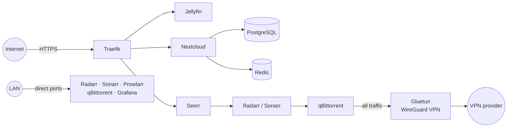

<div align="center">

# NAS-IaC

**Infrastructure as Code for a self-hosted home NAS: private cloud, media server and monitoring, deployed with Ansible and Docker Compose.**

[](https://github.com/HaruSnak/nas-iac/actions/workflows/lint.yml)
[](LICENSE)

[Roadmap](ROADMAP.md) · [Report a bug](https://github.com/HaruSnak/nas-iac/issues) · [Request a feature](https://github.com/HaruSnak/nas-iac/issues)

</div>

## Why NAS-IaC?

I wanted a personal, self-hosted infrastructure on my NAS a private cloud, a media server and monitoring without depending on third-party services.

Running a few `docker compose` files by hand would have been enough for personal use. Instead, I chose to describe the whole setup as code with Ansible: every deployment is reproducible, every change is versioned, and redeploying the whole infrastructure is a single command instead of a list of manual steps to remember.

## Features

- ✅ **Private cloud** Nextcloud with PostgreSQL and Redis
- ✅ **Media server** Jellyfin with Intel GPU passthrough for hardware transcoding, Seerr for requests
- ✅ **Media automation** Radarr, Sonarr and Prowlarr, with qBittorrent routed through a WireGuard VPN (Gluetun) as a kill switch
- ✅ **Reverse proxy** Traefik with automatic Let's Encrypt certificates (Cloudflare DNS challenge), HTTPS redirect and security headers
- ✅ **Monitoring** Prometheus, Grafana, node-exporter and cAdvisor, with provisioned datasource and dashboards
- ✅ **Health checks** every exposed or user-facing service has a health check, and deployments wait for each stack to be healthy before moving on
- ✅ **Generated configuration** every stack's `.env` is rendered from Ansible variables, and deployment fails on any missing value
- ✅ **Dependency updates** all image versions are pinned and kept up to date by Renovate
- ✅ **CI** yamllint, ansible-lint (production profile), Compose validation and secret scanning (gitleaks) on pushes to `main`/`develop` and on every pull request

## Architecture



| Stack | Services | Access |
|---|---|---|
| `traefik` | Traefik, socket-proxy | Internet (only service meant to be forwarded on the router) |
| `nextcloud` | Nextcloud, PostgreSQL, Redis | Internet, through Traefik |
| `jellyfin` | Jellyfin, Seerr | Internet, through Traefik |
| `arr-stack` | Radarr, Sonarr, Prowlarr | LAN only |
| `vpn-stack` | Gluetun, qBittorrent | LAN only (WebUI), torrent traffic through the VPN |
| `monitoring` | Prometheus, Grafana, cAdvisor, node-exporter, socket-proxy | LAN only (Grafana), Prometheus internal |

Each stack has its own internal Docker network; shared networks only exist where two stacks need to talk to each other.

### Security design

- **Zero secrets on GitHub** the repository is public: `vars.yml` and `vault.yml` are never committed, only their `.example` templates. Secrets stay on the admin machine, encrypted with Ansible Vault.
- **Separate deploy and runtime identities** Ansible deploys with a dedicated service account (`s-infra-automation`), while containers run as `svc-containers`: no shell, no password, no sudo, and not in the `docker` group. A compromised container cannot tamper with the account that deploys.
- **Just-in-time service account** the deployment account is expired by default, unlocked at the start of a run and locked again at the end (verified in `/etc/shadow`). If a run is interrupted, `lock-service-account.yml` locks it manually.
- **No direct Docker socket access** Traefik and cAdvisor reach Docker through a read-only socket proxy on an internal network.
- **VPN kill switch** qBittorrent shares Gluetun's network stack: without the VPN tunnel, it has no network at all.
- **SSH hardening** password and root logins are disabled on the NAS (enforced and verified by Ansible); one key per account, and strict host key checking.
- **Supply chain** image versions are pinned, Renovate waits 7 days before proposing a new release, and GitHub Actions are pinned by commit SHA. The CI only gets a read-only token.

## Quick start

### Prerequisites

**Control machine**
- Python 3 and `ansible-core` (tested with 2.21)
- The `community.docker` collection (installed below)

**Target NAS**
- Debian-based Linux with Docker Engine and Docker Compose v2 (tested on a UGREEN DXP2800 running UGOS)
- SSH key access for an admin account and the `s-infra-automation` service account, both allowed to use `sudo`

**External services**
- A domain managed by Cloudflare (DNS challenge for Let's Encrypt certificates)
- A WireGuard configuration from a VPN provider supported by Gluetun (AirVPN here)

### Installation

```bash
git clone https://github.com/HaruSnak/nas-iac.git
cd nas-iac/ansible
ansible-galaxy collection install -r requirements.yml

# Variables and secrets, from the committed templates
cp inventories/production/group_vars/nas/vars.yml.example inventories/production/group_vars/nas/vars.yml
cp inventories/production/group_vars/nas/vault.yml.example inventories/production/group_vars/nas/vault.yml
# → fill in both files, and adjust inventories/production/inventory.yml (NAS IP, users)

# One SSH key per account, and the NAS host key in known_hosts
ssh-keygen -t ed25519 -f ~/.ssh/nas-iac-admin
ssh-keygen -t ed25519 -f ~/.ssh/nas-iac-service
ssh-copy-id -i ~/.ssh/nas-iac-admin.pub <admin-user>@<nas-ip>
ssh-copy-id -i ~/.ssh/nas-iac-service.pub s-infra-automation@<nas-ip>

# Vault password (never committed), then encrypt the secrets
${EDITOR:-nano} .vault_pass && chmod 600 .vault_pass
ansible-vault encrypt inventories/production/group_vars/nas/vault.yml
```

### Usage

```bash
# Dry run: show what would change, without applying anything
ansible-playbook main.yml --check --diff

# Deploy
ansible-playbook main.yml
```

Expected output: the run ends with a recap where no host has failed tasks.

```text
PLAY RECAP *********************************************************
dxp2800-admin    : ok=…  changed=…  unreachable=0  failed=0  …
dxp2800-service  : ok=…  changed=…  unreachable=0  failed=0  …
```

Other playbooks:

| Playbook | Purpose |
|---|---|
| `lock-service-account.yml` | Lock the service account manually (e.g. after an interrupted run) |
| `unlock-service-account.yml` | Unlock the service account manually |
| `reset-all-docker.yml` | Stop and remove every stack (asks for confirmation, keeps the data) |

## Documentation

```text
.
├── .github/workflows/lint.yml       # CI: yamllint, ansible-lint, Compose validation, gitleaks
├── renovate.json                    # Dependency update rules
├── ROADMAP.md                       # Planned work, starting with backups
└── ansible/
    ├── main.yml                     # Entry point: unlock → deploy → lock
    ├── inventories/production/
    │   ├── inventory.yml            # Hosts (admin and service accounts)
    │   └── group_vars/nas/          # vars.yml / vault.yml (+ .example templates)
    └── roles/
        ├── common/                  # Accounts, groups and data directories
        └── docker/                  # Compose files, .env templates and deployment
```

- [Roadmap and backup plan](ROADMAP.md)
- [Variables template](ansible/inventories/production/group_vars/nas/vars.yml.example)
- [Secrets template](ansible/inventories/production/group_vars/nas/vault.yml.example)

## Roadmap

- [x] Ansible roles for accounts, directories and Docker stacks
- [x] `.env` files generated from Ansible variables
- [x] Dedicated runtime account for containers, outside the `docker` group
- [x] Read-only Docker socket proxy for Traefik and cAdvisor
- [x] Pinned images and Renovate
- [x] Health checks on services, with deployments waiting for healthy stacks
- [x] CI with linting, Compose validation and secret scanning
- [x] SSH key authentication with strict host key checking
- [x] Provisioned Grafana datasource
- [x] Single `/data` mount for media, allowing hardlinks between downloads and the library
- [ ] Backups with restic (waiting for external storage, see [ROADMAP.md](ROADMAP.md))
- [ ] Alerting (Alertmanager)

See [ROADMAP.md](ROADMAP.md) for details.

## License

Distributed under the MIT License. See [LICENSE](LICENSE) for details.

## Acknowledgements

- [LinuxServer.io](https://www.linuxserver.io/) for the Radarr, Sonarr, Prowlarr, qBittorrent, Jellyfin and socket-proxy images
- [Gluetun](https://github.com/qdm12/gluetun) for the VPN client container
- [Seerr](https://github.com/seerr-team/seerr), [Jellyfin](https://jellyfin.org/), [Nextcloud](https://nextcloud.com/) and [Traefik](https://traefik.io/)
- Grafana dashboards [Node Exporter Full (1860)](https://grafana.com/grafana/dashboards/1860) and [Docker Container & Host Metrics (10619)](https://grafana.com/grafana/dashboards/10619)
- [Renovate](https://docs.renovatebot.com/) for automated dependency updates
